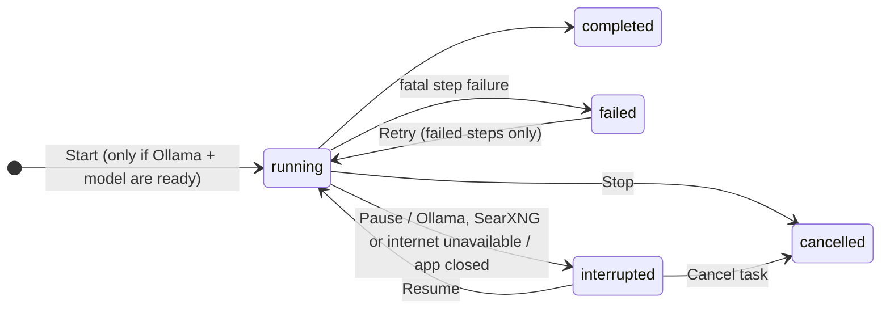
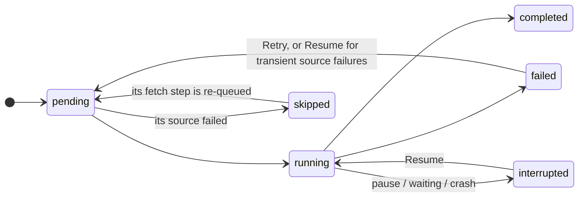

# Research task lifecycle and failure recovery

How an autonomous research task behaves when something goes wrong, and what the user can
do about it. The rules are implemented in
`packages/agent-runtime/src/research/{workflow,failures,config}.ts` and the storage
repositories. They are covered by `research/lifecycle.test.ts`,
`research/workflow.test.ts` and `storage/src/lifecycle.test.ts`.

## Principles

1. **Every step is persisted.** A step's output is saved before the next step starts, so
   nothing that finished is lost or repeated. Starting a `completed` step throws
   `step-already-completed`.
2. **Nothing fails silently.** Every error ends in exactly one of the outcomes below. Each
   outcome is visible on the step, on the task, in the execution log and, for sources, in
   the report's _Review notes_.
3. **No automatic restarts.** After a crash or a missing service, the task waits. Only the
   user's **Resume** or **Retry** runs it again.
4. **No self-approval.** The workflow refuses to call any tool that needs approval or has
   external effects (`tool.refused`). Today it only uses `web_search` and `fetch_source`,
   which are read-only and save only to the app's own knowledge base.
5. **No shell, no file deletion, no external actions.** None of the recovery paths run
   commands, delete files or probe the network on their own.
   - Connectivity is inferred from the requests the task makes anyway.
   - The only extra call is the Ollama health check when a task starts. It goes to the
     local server on `127.0.0.1`.

## Failure classification

| Failure                                                                                                  | Kind                 | Step                               | Task                                                    | What the user does                  |
| -------------------------------------------------------------------------------------------------------- | -------------------- | ---------------------------------- | ------------------------------------------------------- | ----------------------------------- |
| Ollama not reachable, or the model is not installed (after retries)                                      | `model-unavailable`  | `interrupted`                      | `interrupted`: "Waiting for Ollama: …"                  | Start Ollama, then **Resume**       |
| SearXNG not reachable, HTTP 403/5xx from SearXNG                                                         | `search-unavailable` | `interrupted`                      | `interrupted`: "Waiting for SearXNG: …"                 | Start SearXNG, then **Resume**      |
| Internet down: network errors on 2 different sites in a row, or SearXNG reports all engines unreachable  | `offline`            | `interrupted`                      | `interrupted`: "Waiting for the internet connection: …" | Reconnect, then **Resume**          |
| One source cannot be read (404, blocked, timeout…) or its evidence answer is malformed                   | `source`             | `failed`                           | continues                                               | Nothing: it is listed in the report |
| Plan, analysis, report or review fails: malformed output after retries, model timeout, no usable sources | `fatal`              | `failed`                           | `failed`                                                | **Retry**                           |
| User clicks **Pause**                                                                                    | —                    | `interrupted`                      | `interrupted`: "Paused by the user. …"                  | **Resume**                          |
| App closed or crashed                                                                                    | —                    | `interrupted`                      | `interrupted`: "The application stopped…"               | **Resume**                          |
| User clicks **Stop** / **Cancel task**                                                                   | —                    | `failed`: "Cancelled by the user." | `cancelled` (final)                                     | Start a new task                    |

Step errors are stored as `[code] message`, for example `[timeout] slow` or
`[malformed-output] The model's answer was not valid: …`.

When a fetch step fails, the evidence step for that source is set to `skipped`, with the
reason "source N could not be read (…)". The saved report then lists the source under
_Review notes_ as "Source not used: <url> — <reason>". The task output records
`failedSteps`.

## Retries inside a step

Before a step is classified as failed, the call is retried with exponential backoff.

- **Model calls:**
  - Retried on invalid JSON or schema errors, timeouts and server errors, up to
    `modelRetries` extra attempts.
  - For invalid output, the validation error is sent back to the model with the next
    attempt.
  - Before validation, the answer is cleaned: `<think>` blocks and Markdown code fences
    are removed, and surrounding text is cut.
- **Tool calls:**
  - Retried on timeouts, network errors and HTTP 5xx, up to `toolRetries` extra attempts.
  - HTTP 4xx and blocked URLs are never retried.
- **Delay:** `retryBackoffMs × 2^attempt`, capped at 30 s. Each retry is logged
  (`model.retry`, `tool.retry`) with the attempt number and the delay.

## Lifecycle

Task (research workflow):

Step:

`completed` steps are never re-run.

| Action | Allowed when                                                     | Refused with                                                                                          |
| ------ | ---------------------------------------------------------------- | ----------------------------------------------------------------------------------------------------- |
| Start  | Goal valid, `SEARXNG_URL` set, Ollama reachable, model installed | "Ollama is not reachable…", "The model X is not installed. Run "ollama pull X"…" (no task is created) |
| Pause  | Task is running in this app session                              | "Only running research tasks can be paused."                                                          |
| Resume | Task is `interrupted` and not already running                    | "Only interrupted tasks can be resumed…"                                                              |
| Retry  | Task is `failed` and has a failed step that can run again        | "Only failed tasks can be retried…", "There is no failed step that can run again…"                    |
| Cancel | Task is `running`, `interrupted`, `pending` or awaiting approval | Final states cannot be cancelled                                                                      |

### Resume

- The `interrupted` step runs again, with `attempts` incremented. Completed steps keep
  their outputs and are not repeated.
- Sources that failed with a transient code (`network-error`, `dns-failed`, `timeout`,
  `http-error-5xx`) are queued again, together with their skipped evidence steps. This
  only happens while the analysis has not completed yet. Sources that failed permanently
  (404, blocked) are not retried.

### Retry

- Re-queues the failed step that stopped the task.
- If the analysis has not completed, it also re-queues every failed source step and its
  skipped evidence step. For example, when all sources failed, Retry fetches them again.
- Then the task goes `failed → running` in the same transaction.

### After a restart

- Startup recovery marks running tasks and steps `interrupted`. It writes a `task.recovered`
  log entry for each task.
- Nothing runs until the user clicks **Resume**.

## Execution log

Table `task_logs`: append-only, ordered by `seq` per task, and deleted with the task. Each
entry has `level` (debug, info, warn or error), `event`, `message`, an optional `step_id`
and small JSON `data`. Larger data is replaced by a preview.

| Event                                                          | Level |
| -------------------------------------------------------------- | ----- |
| `task.started`, `task.resumed`, `task.retry`, `task.completed` | info  |
| `task.paused`, `task.cancelled`                                | info  |
| `task.waiting`, `task.recovered`                               | warn  |
| `task.failed`, `task.crashed`                                  | error |
| `step.started`, `step.completed`                               | info  |
| `step.failed` (non-fatal), `step.skipped`                      | warn  |
| `model.call`                                                   | debug |
| `model.retry`                                                  | warn  |
| `model.failed`                                                 | error |
| `tool.retry`, `tool.failed`                                    | warn  |
| `tool.refused`                                                 | error |
| `source.read`, `grounding.dropped`                             | info  |

The task page shows the log under **Execution log**. It loads only new entries and has a
level filter. The `tasks:logs` IPC channel returns at most 500 entries after a given `seq`.

## Configuration

Defaults for new tasks come from the environment (`.env` in development). Each task stores
its own limits, so changes only affect tasks started afterwards. An invalid value stops the
app at startup with "Invalid RESEARCH_…".

| Variable                    | Range       | Default |
| --------------------------- | ----------- | ------- |
| `RESEARCH_MODEL_RETRIES`    | 0–3         | 1       |
| `RESEARCH_TOOL_RETRIES`     | 0–3         | 1       |
| `RESEARCH_RETRY_BACKOFF_MS` | 0–60000     | 1000    |
| `RESEARCH_MODEL_TIMEOUT_MS` | 1000–900000 | 300000  |
| `RESEARCH_MAX_QUESTIONS`    | 1–6         | 3       |
| `RESEARCH_MAX_SOURCES`      | 1–12        | 6       |

Limits given for a single task override these defaults. Limits that are left out keep
the configured value.

## Manual checks

See [manual-testing-research-agent.md](manual-testing-research-agent.md), sections 4–7.
