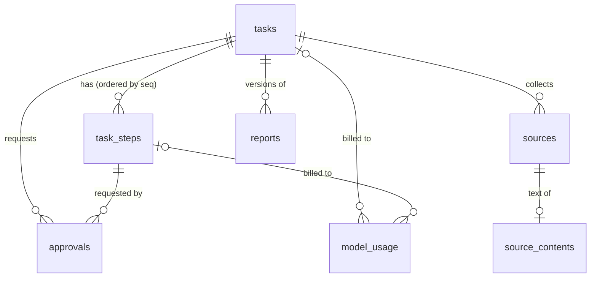
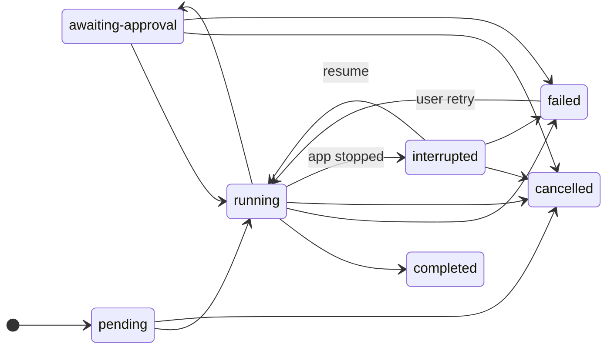
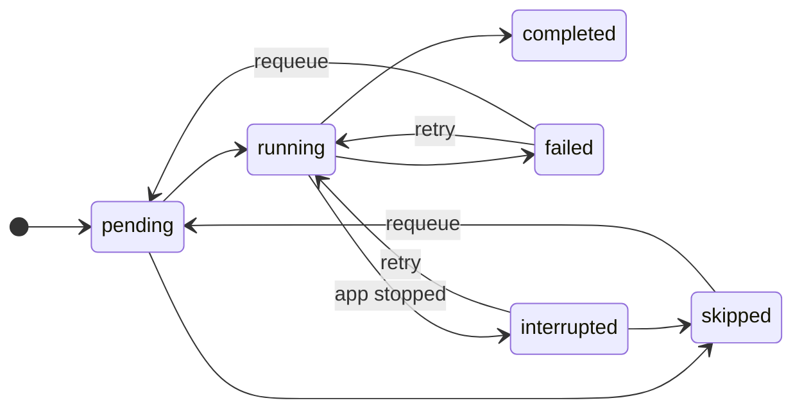

# Database schema

SQLite database for the Autonomous Research & Knowledge Assistant, accessed with
[better-sqlite3](https://github.com/WiseLibs/better-sqlite3) and
[Drizzle ORM](https://orm.drizzle.team).

- **Location:** `%APPDATA%\Autonomous Research Assistant\data\research.db` (Electron `userData`).
- **Source of truth:** [`src/schema.ts`](src/schema.ts). SQL migrations in [`drizzle/`](drizzle) are generated from it.
- **Mode:** WAL journal, `foreign_keys = ON`, `synchronous = NORMAL`, `busy_timeout = 5000`.

## Conventions

| Convention     | Rule                                                                                                                             |
| -------------- | -------------------------------------------------------------------------------------------------------------------------------- |
| Primary keys   | `id` text UUID (`settings` uses `key`)                                                                                           |
| Timestamps     | ISO-8601 UTC text (`2026-11-04T10:00:00.000Z`), sortable. Every table has `created_at` and `updated_at`, set by the repositories |
| JSON columns   | Stored as text; validated with Zod (`z.json()`) before writing — no `undefined`, functions, `Date` objects                       |
| Status columns | Text enums enforced by `CHECK` constraints and by repository state machines                                                      |
| Deletes        | Deleting a task cascades to its steps, sources, contents, reports and approvals; `model_usage` keeps its history (`SET NULL`)    |

## Entity relationships

`settings` is standalone.

## Tables

### `tasks`

A research task: what the user asked (`input`), the result (`output`) and its lifecycle.

| Column                     | Type           | Notes                                                      |
| -------------------------- | -------------- | ---------------------------------------------------------- |
| `id`                       | text PK        | UUID                                                       |
| `title`                    | text, not null | 1–500 chars                                                |
| `input`                    | JSON, not null | The request, e.g. `{ "question": "…", "depth": 2 }`        |
| `output`                   | JSON           | Set when the task completes                                |
| `status`                   | text, not null | See state machine below                                    |
| `error`                    | text           | Failure or interruption reason; cleared when running again |
| `started_at`               | text           | First time the task started running                        |
| `finished_at`              | text           | Set on `completed`, `failed`, `cancelled`                  |
| `created_at`, `updated_at` | text, not null |                                                            |

Indexes: `status`, `created_at`.

### `task_steps`

One execution step of a task. Steps are persisted as they run, so work survives restarts.

| Column                      | Type                 | Notes                                              |
| --------------------------- | -------------------- | -------------------------------------------------- |
| `id`                        | text PK              |                                                    |
| `task_id`                   | text FK → `tasks.id` | `ON DELETE CASCADE`                                |
| `seq`                       | integer, not null    | 1, 2, 3… per task; unique `(task_id, seq)`         |
| `kind`                      | text                 | e.g. `plan`, `search`, `fetch`, `analyze`, `write` |
| `name`                      | text                 | Human-readable description                         |
| `status`                    | text                 | See state machine below                            |
| `input`, `output`           | JSON                 | Step arguments and result                          |
| `error`                     | text                 | Last failure                                       |
| `attempts`                  | integer, default 0   | Incremented each time the step starts              |
| `started_at`, `finished_at` | text                 | Of the latest attempt                              |
| `created_at`, `updated_at`  | text                 |                                                    |

### `sources`

A web source collected for a task. Unique per `(task_id, url)`: adding the same URL again updates it.
The web tools store the **canonical** URL (see `canonicalizeUrl` in `@rka/tools`), so trivially
different URLs of one page collide here. Duplicate checks use `sources.findByUrl(taskId, url)` and
`sources.findByContentHash(taskId, sha256)`, which compares the hash in `source_contents`.

| Column                     | Type                 | Notes                                                                                                                                                                                                                                                 |
| -------------------------- | -------------------- | ----------------------------------------------------------------------------------------------------------------------------------------------------------------------------------------------------------------------------------------------------- |
| `id`                       | text PK              |                                                                                                                                                                                                                                                       |
| `task_id`                  | text FK → `tasks.id` | cascade                                                                                                                                                                                                                                               |
| `url`                      | text                 | `http(s)` only, ≤ 2048 chars                                                                                                                                                                                                                          |
| `title`                    | text                 |                                                                                                                                                                                                                                                       |
| `retrieved_at`             | text                 | When the page was fetched                                                                                                                                                                                                                             |
| `metadata`                 | JSON                 | From `fetch_source`: `requestedUrl`, `finalUrl`, `redirects`, `httpStatus`, `kind`, `contentType`, `byteLength`, `rawSha256`, `truncated`, and when known `description`, `lang`, `author`, `publishedAt`, `siteName`, `declaredCanonicalUrl`, `pages` |
| `created_at`, `updated_at` | text                 |                                                                                                                                                                                                                                                       |

### `source_contents`

Extracted text of a source, kept apart from `sources` so listing sources stays cheap.
**Untrusted data** — never treated as instructions.

| Column                     | Type                           | Notes                                                  |
| -------------------------- | ------------------------------ | ------------------------------------------------------ |
| `id`                       | text PK                        |                                                        |
| `source_id`                | text FK → `sources.id`, unique | One row per source; cascade                            |
| `content_type`             | text                           | e.g. `text/plain`, `text/markdown`                     |
| `text`                     | text                           | ≤ 5 MB (UTF-8)                                         |
| `byte_length`              | integer                        | UTF-8 size                                             |
| `sha256`                   | text                           | Hex digest of `text` (deduplication, change detection) |
| `created_at`, `updated_at` | text                           |                                                        |

### `reports`

Generated reports. Each regeneration adds a new `version`; unique `(task_id, version)`.

| Column                     | Type                 | Notes                                                                                             |
| -------------------------- | -------------------- | ------------------------------------------------------------------------------------------------- |
| `id`                       | text PK              |                                                                                                   |
| `task_id`                  | text FK → `tasks.id` | cascade                                                                                           |
| `version`                  | integer              | 1, 2, 3… per task                                                                                 |
| `title`                    | text                 |                                                                                                   |
| `format`                   | text                 | `markdown`                                                                                        |
| `content`                  | text                 | ≤ 2 MB                                                                                            |
| `cited_source_ids`         | JSON `string[]`      | **Must** reference sources recorded for the same task — the repository rejects invented citations |
| `created_at`, `updated_at` | text                 |                                                                                                   |

### `model_usage`

One row per model call, with token counts when the model reports them.

| Column                                  | Type                                | Notes                                                         |
| --------------------------------------- | ----------------------------------- | ------------------------------------------------------------- |
| `id`                                    | text PK                             |                                                               |
| `task_id`                               | text FK → `tasks.id`, nullable      | `SET NULL` on delete (history kept); null for chat playground |
| `step_id`                               | text FK → `task_steps.id`, nullable | `SET NULL`                                                    |
| `provider`                              | text                                | `ollama`                                                      |
| `model`                                 | text                                | e.g. `qwen3:8b`                                               |
| `purpose`                               | text                                | e.g. `chat`, `plan`, `summarize`                              |
| `prompt_tokens`, `completion_tokens`    | integer, nullable                   | Null when not reported                                        |
| `total_duration_ms`, `load_duration_ms` | integer, nullable                   |                                                               |
| `created_at`, `updated_at`              | text                                |                                                               |

Indexes: `task_id`, `created_at`.

### `settings`

Key/value application settings.

| Column                     | Type              | Notes                                                       |
| -------------------------- | ----------------- | ----------------------------------------------------------- |
| `key`                      | text PK           | `[a-z0-9][a-z0-9._-]{0,99}`, case-insensitive               |
| `value`                    | text              | JSON for normal settings; **base64 ciphertext** for secrets |
| `is_secret`                | integer (boolean) |                                                             |
| `created_at`, `updated_at` | text              |                                                             |

### `approvals`

Human decisions on write actions requested by the agent.

| Column                     | Type                                | Notes                                                              |
| -------------------------- | ----------------------------------- | ------------------------------------------------------------------ |
| `id`                       | text PK                             |                                                                    |
| `task_id`                  | text FK → `tasks.id`                | cascade                                                            |
| `step_id`                  | text FK → `task_steps.id`, nullable | cascade                                                            |
| `action`                   | text                                | Machine-readable, e.g. `file.write`                                |
| `summary`                  | text                                | What the user is asked to approve, in plain words                  |
| `payload`                  | JSON                                | Details of the action                                              |
| `status`                   | text                                | `pending` → `approved` \| `rejected` (decided once, never changed) |
| `reason`                   | text                                | Optional note with the decision                                    |
| `decided_at`               | text                                |                                                                    |
| `created_at`, `updated_at` | text                                |                                                                    |

Indexes: `status`, `task_id`.

### `task_logs`

Append-only execution log of a task (added by migration `0001_task_logs`). Written by the
research workflow; never updated.

| Column       | Type                                | Notes                                          |
| ------------ | ----------------------------------- | ---------------------------------------------- |
| `id`         | text PK                             |                                                |
| `task_id`    | text FK → `tasks.id`                | cascade                                        |
| `step_id`    | text FK → `task_steps.id`, nullable | set null                                       |
| `seq`        | integer                             | 1, 2, 3… per task; unique with `task_id`       |
| `level`      | text                                | `debug` \| `info` \| `warn` \| `error` (CHECK) |
| `event`      | text                                | `^[a-z][a-z0-9.-]{0,59}$`, e.g. `step.started` |
| `message`    | text                                | 1–2000 characters                              |
| `data`       | JSON, nullable                      | At most 4000 characters serialized             |
| `created_at` | text                                |                                                |

`storage.logs.append()` assigns `seq` inside the write; `listByTask(taskId, { afterSeq,
limit, levels })` returns entries in order. Event names are listed in
[docs/failure-recovery.md](../../docs/failure-recovery.md#execution-log).

### `__migrations` (internal)

Applied migrations: `tag`, `hash` (SHA-256 of the SQL), `applied_at`.

## State machines

Enforced by the repositories (`TASK_TRANSITIONS`, `STEP_TRANSITIONS`) with compare-and-set
updates, plus `CHECK` constraints on the allowed values.

`failed → running` is only used by an explicit user **Retry**; it clears `error` and
`finished_at`.

Task steps:

`completed` is final. `steps.requeue(id)` (failed or skipped → `pending`, error cleared) is
how Retry and Resume queue a step again; `steps.skip(id, reason)` keeps the reason in
`error`. Starting a completed step throws
`StorageError('step-already-completed')`, so a completed step can never execute twice.

## Pausing

There is no separate `paused` status, because the CHECK constraint on `tasks.status`
would need a table rebuild. A paused task is `interrupted`, with
`error = "Paused by the user. Resume to continue from the current step."`. Its running step
becomes `interrupted` (`steps.interrupt()`) and runs again on resume. The UI shows such
tasks as _Paused_.

## Recovery of interrupted tasks

On every startup, before any task can run, the desktop app calls
`storage.recovery.recoverInterruptedTasks()`. In one transaction it:

1. sets every `running` task to `interrupted`, with `error = "The application stopped while this task was running."`;
2. sets every `running` step to `interrupted`.

Nothing is executed automatically. Tasks in `awaiting-approval` are left as they are,
since they were not executing.

To continue a task, the runtime calls `storage.recovery.resume(taskId)`. That moves the
task back to `running` and returns a `ResumePlan`:

- `completedSteps`: done, with their outputs, so they are reused rather than re-run;
- `remainingSteps` and `nextStep`: where execution continues (an interrupted step is retried, with `attempts` incremented);
- `pendingApprovals`: approvals still waiting for the user.

`recovery.listResumable()` lists `interrupted` and `awaiting-approval` tasks for the UI.

## Read-only inspection (`storage.inspect`)

The dashboard reads through `storage.inspect`. It adds **no tables or columns**.

- Task, source and report lists with filters, LIKE search and offset pagination.
  Searches escape `%`, `_` and `\`.
- Task details: steps, counts and model-usage totals.
- Source details: metadata plus extracted text.
- Report details: citations resolved in the report's order.
- `status()`: file sizes (db, -wal, -shm), SQLite version, pragmas, applied migrations,
  and row counts for the fixed table list. It never reads setting values.
- `integrityCheck()`: runs `PRAGMA integrity_check` and stores the result under the
  settings keys `storage.integrity.last` and `storage.integrity.lastSuccessAt`.
- `backupTo(path)`:
  - Writes an online `sqlite.backup()` to a temporary file and verifies it with `quick_check`.
  - Only then renames it to the target.
  - Refuses `:memory:` and the live database, WAL and SHM paths.
  - The caller (the native save dialog) is responsible for overwrite confirmation.

## Proposed: conversation history (not implemented)

The chat playground keeps messages in renderer memory only. A minimal design:

- `conversations`: `id`, `title`, `model`, `created_at`, `updated_at`.
- `conversation_messages`: `id`, `conversation_id` (FK, cascade), `seq` (unique per
  conversation), `role` (`user` | `assistant`), `content`, `status`
  (`complete` | `cancelled` | `error`), `model`, `prompt_tokens`, `completion_tokens`,
  `created_at`, `updated_at`.
- A `ConversationRepository` (`create`, `appendMessage`, `list`, `get`, `delete`), with
  `ChatController` in main persisting a turn when it is done or cancelled.

## Secrets

Credentials are never stored in plaintext:

- `settings.set()` refuses keys that look like credentials (`password`, `secret`, `token`,
  `api_key`, `credential`, `private_key`, `auth`, `cookie`, `session`).
- `settings.setSecret()` encrypts with Electron `safeStorage` (DPAPI on Windows, Keychain
  on macOS, libsecret on Linux) and stores base64 ciphertext with `is_secret = 1`. If OS
  encryption is unavailable it throws `encryption-unavailable` and **stores nothing**;
  there is no plaintext fallback.
- `settings.list()` shows secrets as `[encrypted]`; only `getSecret()` decrypts.

## Transactions

`storage.transaction((repos) => …)` runs atomically: all writes commit, or none do.
Nested calls become savepoints. Callbacks must be synchronous: better-sqlite3
transactions cannot span `await`, and async callbacks are rejected.

## Changing the schema

1. Edit `src/schema.ts`.
2. `pnpm --filter @rka/storage db:generate`. This writes `drizzle/NNNN_*.sql` and regenerates
   `src/migrations.generated.ts`, which embeds the SQL in the app bundle.
3. Update this document.
4. `pnpm check`. Tests fail if the schema and migrations drift apart, or if the embedded
   migrations don't match `drizzle/`.

Never edit an applied migration: the runner refuses databases whose recorded hash differs.
It also refuses a database created by a newer app version.
